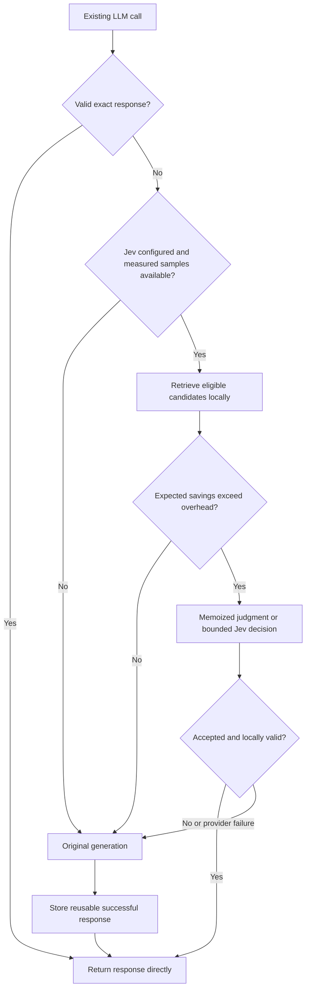
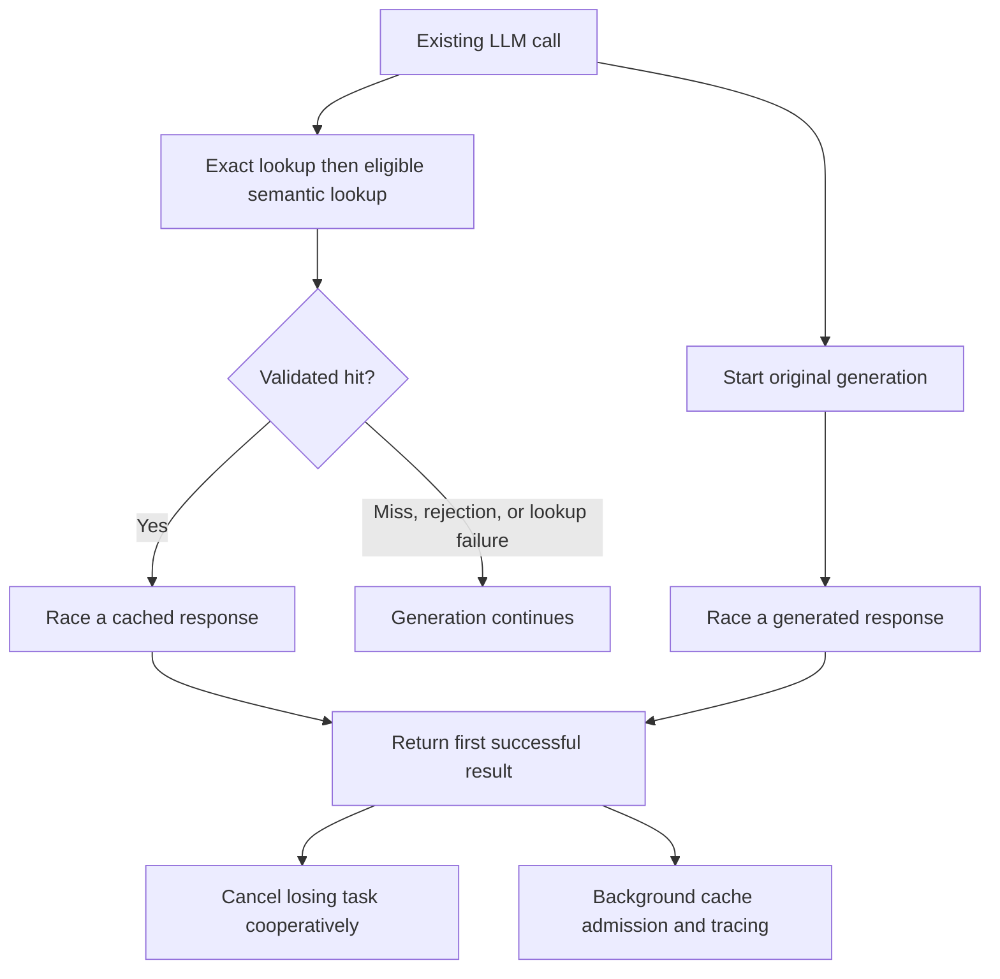

# JAC design

## Primary contract: intercept an LLM call

The primary API is `cached = JAC(...).wrap(existing_llm_call)`. The wrapper accepts
the original call's arguments and returns its response directly. In the default
`mode="cache_first"`, a valid final response hit performs zero generative LLM
calls and a miss performs the original generation. Optional `mode="parallel"`
races reuse against generation. Applications need not introduce a plan, operation
registry, or graph to use either path.

Optimize end-to-end p50/p95 latency first, then reduce LLM/tool execution.
Correctness is an admissibility constraint: the application defines an acceptable
reuse error budget, and an optimization exceeding it must be rejected regardless
of latency improvement.

The outer agent still controls its workflow. Caching an LLM output does not
automatically cache every external tool the agent subsequently calls. Where the
wrapped function itself produces the final answer, a hit skips that function's
entire implementation.

## Cache-first execution path



Exact lookup precedes semantic retrieval. A semantic rejection or provider timeout
adds work to the normal generation path; that work must be included in latency.
There is no retry on Jev's critical path. A memoized judgment still requires local
eligibility and optional validation checks.

## Parallel execution path

```python
cache = JAC(path="jac.sqlite", mode="parallel")
cached = cache.wrap(existing_llm_call)
```



A miss, rejection, failed lookup, or pending decision cannot hold a completed
generation. A generation winner returns without waiting for the lookup branch.
A valid cache winner requests cancellation of the generation branch. The response
path defers storage and telemetry writes; `await cache.drain()` (or synchronous
`cache.drain_sync()`) completes pending background work before shutdown or a
durability check. Identical eligible concurrent calls share one owner race. If
generation fails while lookup is pending, a valid cache hit may still succeed;
if lookup misses, the original generation exception propagates.
Keep JAC alive across requests and drain at shutdown. Draining after every return
can wait for losing work. Async context-manager exit drains automatically;
synchronous context-manager exit drains with `drain_sync()` outside an async loop.

The latency tradeoff changes call accounting. Generation starts speculatively, so
an exact or semantic hit in parallel mode can still incur a provider call and
charges. Cooperative task cancellation does not guarantee the remote provider
stops execution or billing. Async calls can honor cancellation. Sync calls run in
worker threads; canceling their awaiter cannot stop an already running Python
thread. Streaming calls bypass the race.

Parallel mode removes lookup waiting from misses, not every local overhead.
Scheduling, request serialization, cache validation, and resource contention must
still be measured. Cache-first remains the default for applications prioritizing
calls eliminated, and parallel mode is available when miss latency matters more.
The semantic branch uses the same scope, freshness, codec, deterministic guards,
and measured-policy gate in either mode.

## Identity, validity, and response behavior

An exact entry is identified by callable namespace, every supplied positional and
keyword argument, response contract, and `Context`. The context contains scope,
dependency revisions, and policy version. TTL defaults to 300 seconds. Namespace
and context isolate reuse; they are application-owned declarations rather than an
authentication system or automatic discovery of a tenant's permissions.

Plain functions without captured state use their qualified name, code fingerprint,
and JSON-compatible defaults. Closures, partial functions, bound methods, and
callable objects receive isolated identities, so different configured instances
cannot share an answer merely because their qualified names match. Supply an
explicit stable namespace for durable reuse of those callables across process
restarts. External data, mutable hidden state, environment-dependent defaults, and
business rules need declared dependency revisions or identity changes. The cache
cannot infer them from a Python call signature.

The SDK client proxy includes provider, endpoint, and a digest of public client
configuration such as base URL, organization/project, and default headers/query.
The digest avoids persisting raw credentials in namespace text and separates
different account/routes. It does not anonymize model request content. Client
clones remain wrapped, and namespaces are resolved at invocation so configuration
changes also affect retained `.create` references.

Native JSON response values are stored as JSON snapshots. Typed model responses
are serialized with a model codec and reconstructed on hits. A type inferred from
an initial miss is available to that JAC object; an explicit `response_type` makes
the decoder available after restart. Known installed provider models supply their
codec through the adapter. An unavailable codec passes the known SDK call through
instead of replacing its model response with a dictionary.

Streaming calls and unsupported inputs or outputs pass through to the original
function. Failed generation is not cached. A hit contains original response
metadata, including response IDs and usage; it is not a newly issued provider
response. Local tracing supplies actual generation/reuse accounting.

Concurrent exact calls coalesce within a JAC instance. Each caller receives a
decoded response and can apply its local validator. This coalescing is not a
distributed lock or a cross-process guarantee. Canceling a waiting request does
not cancel the original generation; if the owner cancels, another live caller
can execute normally. Sync and async callable interfaces are preserved. Cache-first
retains the caller's thread for synchronous provider execution; parallel mode uses
a worker thread. Unsupported awaitable
objects returned by synchronous functions pass through unchanged. Close the cache
after outstanding calls and parallel background work finish.

Cache failures do not replace a successful provider response. Malformed durable
entries are ignored. SQLite's default busy timeout is 5 ms per operation; cache
and telemetry writes yield to normal execution when another process holds a write
lock. This bounds lock waiting, not filesystem stalls or storage hardware latency.

An optional `validator(request_mapping, response)` runs before admission and on
hits. It returns a boolean, may be async, and should be cheap and local. Requests
are supplied as `args` and `kwargs`. A validator's coverage is part of the
application's correctness contract; it is not an independently calibrated
certificate of response correctness.

## Bounded semantic reuse

Semantic eligibility varies only final user text: the last textual user message,
a textual `input`/`prompt`, or the supported textual positional input. All other
arguments, settings, system instructions, previous messages, scope, source
dependencies, and response contract remain fixed. Numeric literal anchors are a
deterministic equality guard. They do not resolve entities, dates, units, or
arbitrary constraints from free-form prose.

Local retrieval finds a small candidate shortlist. The official Jev adapter sends
two independent Noul questions per candidate in one request:

1. Do the new request and cached request require the same final answer?
2. Does the stored artifact completely supply the new request's required output
   without generation or tools?

Both values must meet the threshold. Ranking uses their minimum with stable
candidate IDs as tie breakers. Probabilities are not multiplied, and a model
score is not treated as a measured valid-hit rate. Insufficient evidence means
rejection. Tool-action responses are excluded from semantic direct reuse.

The adapter uses the official TypeSafe System One endpoint, pins `jev-1.13.0`,
validates returned model and question IDs, checks finite probabilities, and bounds
request size and duration. The default 0.99 threshold is an initial setting for
evaluation, not a correctness guarantee. Generation behavior on misses is
unchanged; Jev's adapter itself does not retry.

Judgment identity includes the request, candidate content, provider, pinned model,
threshold, and question schema version (`reuse-v1`). A changed artifact or
configuration needs a different judgment. A promoted semantic answer retains
its decision identity so changing model/threshold/schema cannot silently turn
that earlier judgment into a permanently trusted exact answer.

Scope and dependency checks are local. Live semantic requests send the complete
relevant call context and candidate response content to TypeSafe. Hashed identities
support matching and change detection; they do not make those provider requests
private.

## Select Jev only when measured savings justify it

Let `p` be the empirically observed rate of verified valid reuse opportunities,
`T_avoided` the generation time eliminated by a full hit, and `L` the retrieval plus
decision overhead. Invoke Jev only if:

```text
p * T_avoided > L
```

`cached.observe_reuse(request_kwargs, valid_hit=..., decision_ms=..., request_args=())`
records independently labeled outcomes and measured decision time in a comparable
cohort. SDK `.create` proxies expose the same helper. The cohort accounts for the
callable, settings and history guard, scope, response contract, policy version,
dependency names, and decision identity. The default policy needs 20 samples.

Cold start deliberately uses exact reuse and normal generation. Obtain the
observations through held-out evaluation or shadow execution. Model acceptance
alone does not establish a valid reuse label, and ordinary cache hits do not
fabricate semantic calibration data. Different models or histories may create
different cohorts with insufficient observations.

The invocation policy controls expected overhead; it cannot by itself guarantee
p95 improvement. In parallel mode, it bounds avoidable decision work while lookup
races generation rather than preceding it. Rejected candidates, failures, local validators, serialization,
SQLite work, and coalesced wait time all belong in end-to-end latency. Performance
on a representative workload determines whether semantic reuse should be enabled.

## Instrumentation and evaluation

`cache.last_trace` reports the current calling context's path, total latency,
generation and Jev call counts, decision status, and events. `cache.stats()`
aggregates requests, hits, LLM/Jev calls, errors, p50, and p95 for wrapped callables.
Tracing records operation metadata rather than prompt/response payloads; cache
entries retain the data needed for reuse.

Parallel traces also report `mode`, `race_winner` (`cache`, `llm`, or `coalesced`),
`speculative_llm_calls`, and `llm_cancellation_requested`. These count executions
started and cancellation requests, not completed work or confirmed provider
charges. Read response latency before a shutdown drain to measure the race path.

The local CLI compares no cache, exact cache, lexical selection without Jev, and
selective simulated Jev decisions. It uses artificial generation delays and a
golden-output decision fixture. Its known answers expose incorrect lexical reuse
and its rejected/failed decisions expose overhead. These results demonstrate
execution and accounting, not live provider accuracy or production savings.

Production evaluation needs repeated inputs, paraphrases, changed constraints,
different model/settings/history, expired TTLs, revised sources, distinct scopes,
typed response restoration, and rejected reuse opportunities. Select policy and
thresholds on evaluation data, then measure latency and incorrect reuse on held-out
requests. The application owner sets statistical confidence and error budgets.
Zero errors in a small synthetic run cannot establish a production rate.

## Optional advanced workflow reuse

The separate `jevcache.Runtime` API can adopt explicit `Request`, `Context`, `Plan`,
`Node`, and `Ref` graphs when an application also wants to skip planning and
intermediate execution. It is a lower-level extension; the convenient JAC wrapper
does not require it.

| Artifact | Work skipped | Runtime v0.1 rule |
| --- | --- | --- |
| Final response | Full workflow | Exact or selectively validated semantic reuse |
| Tool/intermediate output | Matching read-only node | Exact resolved arguments and validity context |
| Parameterized plan | Planning call | Deterministic compatibility and explicit input rebinding |

Only allowlisted versioned operations execute. `Ref.input(...)` binds structured
parameters, `Ref(...)` binds prior results, and `Ref.text()` binds current request
text. Plans default to `text_independent=False`; changed-text reuse requires
explicit text binding or an explicit assertion that wording cannot change the
workflow. Source dependencies and TTLs propagate downstream. Side-effect nodes
and enclosing final answers are not cached or coalesced.

The graph runtime requires a local `final_validator` for final admission and hits.
It estimates remaining critical-path savings after exact node hits. Semantic Jev
routing in v0.1 covers final responses only; the decider has plan/intermediate
questions, but semantic shared-subgraph reuse remains a future validated extension.

## Official references

- [OpenAI Python client interface](https://developers.openai.com/api/reference/python)
- [OpenAI Responses create method](https://developers.openai.com/api/reference/python/resources/responses/methods/create)
- [Anthropic Python SDK](https://platform.claude.com/docs/en/cli-sdks-libraries/sdks/python)
- [TypeSafe request and response contract](https://docs.typesafe.ai/api)
- [Noul primitive](https://docs.typesafe.ai/primitives/noul)
- [Pinned model versions](https://docs.typesafe.ai/models)
